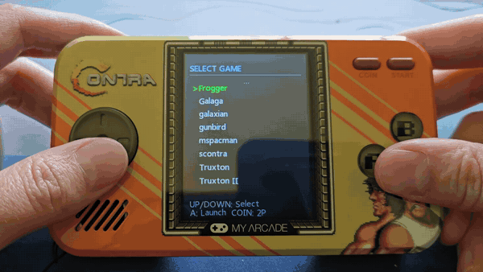

# contra-pocket-mod

<p align="center">
  
  
  
  
</p>

Firmware modding toolkit for the **My Arcade Contra Pocket Player** handheld. Replaces the stock launcher with a custom game menu that lets you load your own arcade ROMs, then rebuilds the NAND image for flashing back to the device.

<div align="center">
  <a href="https://youtu.be/FkxIYgoh6bo"></a>
  <br><br>
  <a href="https://youtu.be/FkxIYgoh6bo"></a>
</div>

The device runs a Rockchip RK3128 (quad-core ARM Cortex-A7, Mali400 MP2) with 128 MB SPI NAND flash and a 240x320 portrait screen perfect for shmups (shoot 'em ups).

This mod replaces the stock game launcher with a custom MiniGUI application that scans for ROM zips and presents a scrollable game menu. The entire build process is automated. The pipeline extracts your firmware, cross-compiles and injects the launcher, injects your added ROMs, and rebuilds a flashable NAND image.

## What You'll Need

*As an Amazon Associate I earn from qualifying purchases. This section contains an affiliate link. Using it is optional, costs you nothing extra, and helps fund future projects.*

- [My Arcade Contra Pocket Player](https://link.amazon/B0dQU0zL2) (affiliate link): the target device
- A micro-USB cable for dumping and flashing the NAND
- Docker, Python 3.10+, and `rkflashtool`

## Project Structure

```
contra-pocket-mod/
├── docker/              # Dockerfile + compose for cross-compile toolchain
├── apps/
│   ├── launcher/        # Custom game launcher (MiniGUI, C)
│   ├── btntest/         # Button/input test utility
│   └── include/minigui/ # MiniGUI 3.2 headers (see ORIGIN file for provenance)
├── tools/
│   ├── mod.py           # Main entry point - full pipeline
│   ├── extract.py       # Standalone partition extraction
│   ├── rebuild.py       # Standalone NAND rebuild
│   └── lib/             # Helpers (GPT parser, NAND I/O, squashfs)
├── firmware/
│   ├── dumps/           # NAND dumps (not checked in)
│   └── extracted/       # Extracted partitions (not checked in)
├── ROMS/fzip/           # ROM zips + names.cfg (see names.cfg.example)
├── build/               # Build output (not checked in)
└── images/              # README media
```

## Getting Started

1. Clone the repo:

   ```bash
   git clone https://github.com/Kc57/contra-pocket-mod.git
   cd contra-pocket-mod
   ```

2. Build the Docker toolchain (one-time; can take several minutes or more depending on your machine):

   ```bash
   cd docker
   docker build -t contra-toolchain .
   cd ..
   ```

   > **macOS:** If the build fails with `docker-credential-desktop: executable file not found`, the `docker` CLI on your PATH (often Homebrew's) can't find Docker Desktop's credential helper. Either add it to your PATH (`export PATH="/Applications/Docker.app/Contents/Resources/bin:$PATH"`) or remove the `"credsStore": "desktop"` line from `~/.docker/config.json`.

3. Install Python dependencies:

   ```bash
   uv sync
   ```

   Or, if you're not using `uv`:

   ```bash
   pip install rich
   ```

4. Install `rkflashtool` for reading/writing the device's NAND flash over USB:

   **macOS (Homebrew):**

   ```bash
   brew install rkflashtool
   ```

   **Linux (build from source):**

   ```bash
   git clone https://github.com/linux-rockchip/rkflashtool.git
   cd rkflashtool
   make
   sudo make install
   ```

## Dump Your Firmware

Connect the device to your PC via the micro-USB cable, then enter RockUSB Mask ROM mode: hold the **Volume Up** button, power on while still holding it.

> **Linux:** `rkflashtool` needs root access. Prefix the commands below with `sudo` unless you've added a udev rule for Rockchip USB devices (vendor ID `2207`). macOS doesn't need `sudo`.

1. Verify the device is detected by reading one sector:

   ```bash
   rkflashtool r 0 1 > /dev/null
   ```

   You should see `Detected RK312X...` and `reading flash memory ... Done!`.

   > `rkflashtool v` (chip info) hangs on this device's loader after "interface claimed", so press Ctrl+C if you try it. Avoid `rkflashtool n`, too: it misreads the SPI NAND and can leave the USB connection stuck until you power-cycle the device.

2. Dump the full 128 MB NAND:

   ```bash
   rkflashtool r 0 262144 > nand_dump.bin
   ```

3. Copy the dump into the project:

   ```bash
   cp nand_dump.bin firmware/dumps/nand_original.bin
   ```

> **Recommended:** Dump twice and compare hashes to catch read errors. If the hashes don't match, dump again until you get two that agree. Keep a copy of the verified dump somewhere safe outside this repo, it's your only way to restore the device if a flash goes wrong.
>
> ```bash
> rkflashtool r 0 262144 > nand_dump_2.bin
> sha256sum nand_dump.bin nand_dump_2.bin
> ```

## Add ROMs

Place FBA-compatible ROM zips in `ROMS/fzip/`.

The device uses the **FBAlpha (FBA)** libretro core for emulation. Arcade ROM sets are version-specific, so you need ROMs from a FinalBurn Alpha compatible set. If a game fails to load, it is most likely a ROM set version mismatch.

**Space is limited.** The rootfs partition is capped at 65 MiB and the stock firmware already uses about 50 MiB of that. This leaves roughly 15 MiB for the custom launcher, ROMs, and any other modifications. The pipeline will error out if the repacked rootfs exceeds the partition limit, so stick to smaller ROM zips.

You can optionally set display names by copying `ROMS/fzip/names.cfg.example` to `ROMS/fzip/names.cfg` and editing it:

```
# rom_stem=Display Name
1941=1941: Counter Attack
digdug=Dig Dug
truxton2=Truxton II
```

Games without an entry in `names.cfg` display their zip filename.

## Build the Modded Image

Run the pipeline in interactive mode (prompts at each step):

```bash
uv run tools/mod.py
```

(If you installed with `pip` instead of `uv`, use `python3 tools/mod.py`.)

Or in headless mode (no prompts). First copy the example config and adjust paths as needed:

```bash
cp mod_config.example.yaml mod_config.yaml
uv run tools/mod.py --config mod_config.yaml -y
```

The pipeline runs five stages:

1. **Validate** -- checks the NAND dump size and GPT partition structure
2. **Extract** -- extracts partitions and unpacks the rootfs into a Docker volume
3. **Compile** -- cross-compiles the custom launcher using the Docker toolchain
4. **Mod** -- installs the launcher binary and copies ROMs into the rootfs
5. **Rebuild** -- repacks the rootfs and assembles the final NAND image

The output lands at `build/firmware/nand.bin`.

### Why Docker?

Docker serves two purposes in this pipeline. First, it provides the Buildroot 2018.02.12 cross-compilation toolchain with the exact glibc and shared library versions the device expects. Second, it handles all squashfs packing and unpacking -- the device's rootfs contains case-sensitive symlinks that macOS's case-insensitive filesystem corrupts during extraction.

The unpacked rootfs lives in a Docker named volume (`contra-rootfs`), not on your host filesystem. All modifications -- installing the launcher, copying ROMs -- happen inside containers that mount this volume. You won't find the unpacked rootfs anywhere on your host disk. When the pipeline rebuilds, it repacks the rootfs from the volume into a squashfs image and writes the final NAND binary back to `build/firmware/` on the host.

## Flash the Device

> **Note:** This writes the full 128 MB image, including the `userdata` partition, so any saves or settings on the device are reset.

1. Enter RockUSB Mask ROM mode: connect via micro-USB, hold **Volume Up**, then power on.
2. Write the modded image:

   ```bash
   rkflashtool w 0 262144 < build/firmware/nand.bin
   ```

3. Reboot the device:

   ```bash
   rkflashtool b
   ```

## Restoring Stock Firmware

If something goes wrong, flash your original backup:

```bash
rkflashtool w 0 262144 < /path/to/your/backup/nand_dump.bin
```

## Notes

- **Standalone tools** -- `tools/extract.py` and `tools/rebuild.py` can be used independently outside the full pipeline.
- **Cleanup** -- remove the Docker volume when you're done: `docker volume rm contra-rootfs`
- **Dry run** -- use `uv run tools/mod.py --dry-run` to preview all actions without executing them.
- **Multiplayer** -- two-player mode via the CO/VS link cable is partially supported but needs more testing. Some games may desync during play, and the multiplayer option currently appears for all games regardless of whether they actually support it.

## Acknowledgments

- [MyArcadeContraDoc](https://github.com/MrMiracleMan111/MyArcadeContraDoc) by MrMiracleMan111: figured it out while it was unclear if my Part II blog would ever see the light of day. Great work, and worth a read for the neat ADB-over-USB trick.
- Built on [MiniGUI](https://github.com/VincentWei/MiniGUI), [Buildroot](https://buildroot.org), [rkflashtool](https://github.com/linux-rockchip/rkflashtool), and [libretro](https://www.libretro.com).

## License

This project uses two licenses:

- **`apps/`** (the custom launcher, the button test utility, and the vendored MiniGUI headers): [GPL-3.0-or-later](apps/LICENSE). The launcher is built on [MiniGUI](https://github.com/VincentWei/MiniGUI), which is GPL-licensed, so these apps are too.
- **Everything else** (the Python pipeline, the Docker toolchain, and the configuration): [MIT](LICENSE).

## Disclaimer

- This project is not affiliated with, endorsed by, or sponsored by My Arcade or Konami. Contra is a trademark of its respective owner.
- No ROMs or firmware images are included. You must supply your own legally obtained copies.
- Flashing modified firmware can brick your device. Keep a verified backup of your original NAND dump, and use this project at your own risk.
